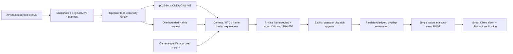

# Command-line pipeline (advanced)

The command-line stages behind the saved sidewalk cases and the Linux A10G runner. The application's **New assessment** drives the same acquisition, detector and Hafnia stages from the browser (see [New assessment](new-assessment.md)); use this page only to run or inspect those stages by hand. It was written for the scooter camera, so camera names below are examples.

Use Windows Python 3.11 (`uv sync --frozen`) and existing MilestonePSTools on the
XProtect machine. Use the existing ML environment on `p022-linux`, with actual
CUDA, pinned OWL-ViT revision and torchvision compatible with its installed torch.
The ML dependency group is opt-in (`uv sync --group ml`); the Windows operator
workflow and private viewer generation require only the standard library.
No service, account, network or firewall changes are part of setup.

Verify exact name/GUID mapping in ignored `cameras.local.json`. The initial
workflow is intentionally restricted to the verified scooter camera. Open each
private geometry review image, correct the polygon if necessary, and record
`approved: true`, `approved_by`, `approved_at` and `reference_frame_sha256` in its
camera-specific `spatial.local.json` only after actual operator approval. These
files are operator attestations, not an authentication/authorization system.

The minimal full analysis invocation, in a user-opened terminal, is:

```powershell
.\.venv\Scripts\python.exe scripts/adaptive_watch/incident.py run --root runs/hybrid/live-sidewalk-20261023 --spatial runs/hybrid/sidewalk-v2/review-scooter/spatial.local.json --ssh-user ubuntu --identity C:/PATH/TO/EXISTING/IDENTITY
```

Replace the identity path and, if necessary, `--linux-python` with the existing
Linux ML interpreter. Do not create accounts or copy private keys. The command
acquires a recent 15-second recording and MKV, then pauses for visual continuity
review. A recording sequence can cross a synthetic clip boundary; reject that
interval rather than treating reset as removal. If it lacks placement/stationarity,
retain the record and start a separately reviewed acquisition. No fabricated
onsets or semantic outcomes are substituted.

The analysis stage copies hash-verified snapshots and a hashed runner/config to
a per-incident `/tmp/adaptive-watch-*` directory over SSH. It runs OWL-ViT on
`p022-linux` with mandatory CUDA. It submits at most one exact matching inline
Hafnia request, through an interactive terminal password prompt, with a persistent
claim-before-submission ledger and a 60-second poll budget. Passwords stay in the
terminal. Reuse the same root and `analyze` stage to poll a known pending ID;
never delete a ledger or change roots to retry an unknown request.

```powershell
.\.venv\Scripts\python.exe scripts/adaptive_watch/incident.py analyze --root runs/hybrid/live-sidewalk-20261023 --spatial runs/hybrid/sidewalk-v2/review-scooter/spatial.local.json --ssh-user ubuntu --identity C:/PATH/TO/EXISTING/IDENTITY
```

Outputs are `joined.json`, `proposal.xml`, `proposal.json`, and `review/index.html`.
Open the HTML directly; no web server is needed. It loads only the copied private
images and local evidence. Original MKV remains with acquisition; timestamped
frame playback is authoritative for overlay alignment. Do not infer UTC alignment
from MKV PTS without comparing it with server-timestamped snapshots.

Retrospective review export is separate and makes no requests:

```powershell
.\.venv\Scripts\python.exe scripts/adaptive_watch/review_sidewalk.py runs/hybrid/sidewalk-v2/scooter-joined.json --manifest runs/xprotect/escooter_left_across_sidewalk_20261022T110435Z/manifest.json --out runs/hybrid/sidewalk-v2/review-scooter
```

After explicit configuration authorization and actual Management Client setup,
review the evidence and exact XML. Send only through the separate action below,
using the **existing** persistent native dispatch ledger, not a new temporary DB:

```powershell
.\.venv\Scripts\python.exe scripts/adaptive_watch/incident.py dispatch --root runs/hybrid/live-sidewalk-20261023 --spatial runs/hybrid/sidewalk-v2/review-scooter/spatial.local.json --ledger C:/PATH/TO/EXISTING/analytics.sqlite3
```

It requires configuration confirmation, incident review and the full XML SHA-256
in the terminal. It reserves the camera/interval transactionally before POST,
blocks overlapping episodes in that same ledger, and never retries automatically.
Disjoint windows from the same synthetic scene are still correlated; review the
episode before authorizing a later event. A retained reservation after a crash
requires operator investigation, never deletion as an automatic retry mechanism.
Known/unknown dispatch outcomes remain in the existing ledger. Use its existing
reconciliation workflow to document Smart Client/Event Server checks. This
workflow deliberately does not automatically release episode reservations.

Acceptance is written to `acceptance.json`. Enter the actual dedicated sidewalk
alarm ID and overlay observation only after checking Smart Client; they are saved
in `operator-alarm.json`. Empty HTTP 200 alone is not alarm verification.

## Architecture and evidence boundaries



The join re-verifies manifest identity, each original timestamped frame, exact
Hafnia request/returned request, camera and interval. Polygon/box intersection is
image area, not segmentation or accessible width. Largest-box association can
switch objects. Three-second sampled stationarity is a demonstration threshold.
Fresh decisions require strict semantic responses: repairs/normalizations stay
visible but block dispatch readiness. Automatic dispatch eligibility is always
false, even when an incident is ready for operator review.

EventHeader Timestamp is the first stationary source sample, so playback can find
the evidence; StartTime/EndTime preserve the analysis interval. Event creation UTC
is recorded separately in metadata and description. One ObjectList bounding box
matches that timestamp. Native rendering must be verified in this installation.

Motion alone indicates image change. Hafnia alone supplies semantic assessment.
Adaptive Watch adds localized timestamped samples and bounded stationarity, with
explicit uncertainty and approval gates. This is a functional comparison, not an
independently labeled accuracy comparison.

Run `python -m unittest discover -s tests` for checks. Keep recordings, screenshots,
raw responses, camera catalogs, identities and local configuration out of Git.
The public repository contains code, tests and documentation, never private
viewer exports or demonstration footage. See [the actual demo sequence](../archive/final-integration.md).
